  

  
  
  

### About

I've been writing software since 2013. I started with websites and SEO; in recent years I've built .NET desktop apps, web apps with Next.js and iOS/Android apps with React Native. I've applied SOLID, OOP and Clean Code principles in my projects and keep building that way.

Today I work with several AI models and agents and orchestrate how they work together. AI has widened the range of projects I can take on and cut delivery times considerably; it also lets me build in languages I haven't fully mastered, such as Rust.

### Stack

   
   
  

**Mobile:** React Native · Expo · SwiftUI 
**AI:** Claude Code · multi-agent workflows · local models: Ollama, SDXL / FLUX, LTX-Video, Wan, Whisper

### Projects

| Project | What it does | Stack |
| --- | --- | --- |
| **ProjectLocal** | AI video production app that runs locally: script, storyboard, visuals, voice-over, subtitles and dubbing in 23 languages. Built for an 8 GB laptop GPU. [Windows installer](https://github.com/batuhanDoymaz/ProjectLocal-releases) | Python · FastAPI · React · Ollama |
| **HomeMesh** | Open-source, self-hosted device management for your own Windows, Linux and macOS machines: monitoring, terminal, file transfer, clipboard sync, keyboard and mouse sharing. | Rust · Web |
| **KantineCore** | Canteen POS and stock management: web, iOS and Android from one codebase, with live order and stock updates. | Next.js · Fastify · PostgreSQL · Expo |
| **VESQR** | QR menu and restaurant platform: guest menu, waiter and kitchen panels, floor plan editor, reports. | Next.js · TypeScript |
| **Local SEO Platform** | Generates, checks and deploys many local business sites from one repo, with lead forms and uptime monitoring. | Python · Cloudflare Workers |
| **Local AI Studio** | Virtual 3D studio pipeline: JSON shot plan, Blender preview, final render. | Python · Blender |

Most of my client and product work is in private repositories. I'm happy to walk through the code in a call.

### Activity

  

<b>Türkçe</b>

 

2013'ten beri yazılım geliştiriyorum. Web siteleri ve SEO ile başladım; son yıllarda .NET masaüstü uygulamaları, Next.js ile web uygulamaları ve React Native ile iOS/Android uygulamaları geliştirdim. Projelerimde SOLID, OOP ve Clean Code prensiplerini uyguladım ve bu şekilde geliştirmeye devam ediyorum.

Bugün birden fazla AI modeli ve ajanla çalışıyor, bu modellerin orkestrasyonunu yönetiyorum. Yapay zekâ, geliştirebildiğim projelerin kapsamını genişletti ve teslim sürelerini ciddi ölçüde kısalttı; tam olarak hâkim olmadığım dillerde de (örneğin Rust) proje geliştirebiliyorum.

